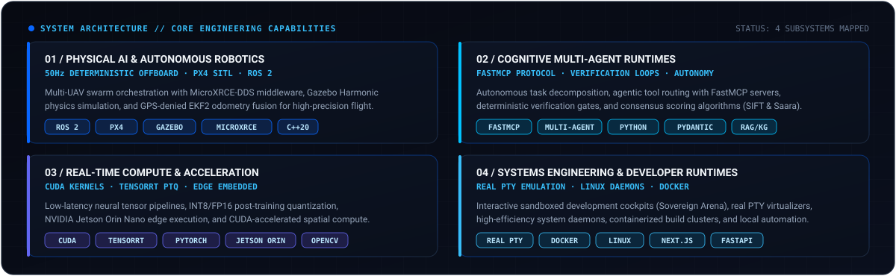
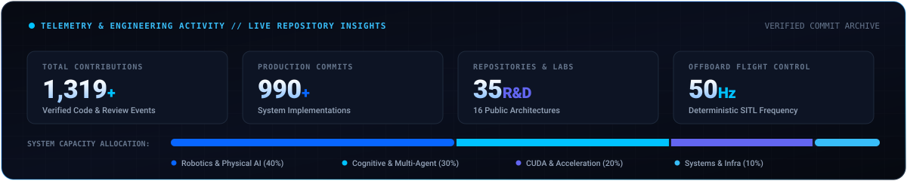

<!-- ================================================================= -->
<!-- META DESIGN SYSTEM // SYSTEM KERNEL NX-49023                      -->
<!-- ARCHITECTURE: PHYSICAL AI · AUTONOMOUS ROBOTICS · MULTI-AGENT     -->
<!-- ================================================================= -->

  

  
  
  
  

---

### 🌐 System Architecture & Core Disciplines

  

 

---

### 🛸 Flagship Engineering Systems

| System & Architecture | Core Specifications & Capabilities | Stack & Status |
| :--- | :--- | :---: |
| 🛸 **[Project SUTRA](https://github.com/nikhil49023/SUTRA)** Autonomous Multi-UAV Swarm | • Deterministic 50Hz offboard setpoint streaming • PX4 Autopilot SITL & ROS 2 Humble integration • GPS-denied EKF2 odometry via MicroXRCE-DDS • Gazebo Harmonic multi-agent physics validation | `ROS 2 Humble` `PX4 SITL` `C++20`  `● PRODUCTION` |
| ⚔️ **[Sovereign Arena](https://github.com/nikhil49023/sovereign-arena)** High-Velocity Systems Cockpit | • Real PTY terminal virtualizer with sub-millisecond I/O • Multi-language sandboxed execution environments • Monaco Editor integration & Obsidian bidirectional sync • Low-latency containerized execution architecture | `Next.js 14` `Monaco Engine` `Real PTY`  `● STABLE v1.2` |
| 🧠 **[SIFT Intelligence](https://github.com/nikhil49023/sift)** Decision & Profiling Engine | • Autonomous multi-agent engineering profiling • FastMCP protocol tool-calling execution pipelines • Deterministic hackathon jury scoring algorithms • Multi-round consensus & discrepancy reconciliation | `FastMCP` `Python 3.12` `Multi-Agent`  `● ACTIVE DEPLOYED` |
| ⚡ **[OmniForge](https://github.com/nikhil49023/omniforge)** Autonomous MCP Studio | • Autonomous docs-to-FastMCP server generation studio • System 1 triage pipeline with Firecrawl headless crawler • Groq LPU low-latency inference synthesis • Automated schema validation & tool deployment | `FastMCP` `Firecrawl` `Groq LPU`  `● RELEASED` |
| 🖥️ **[SAARA Desktop](https://github.com/nikhil49023/saara-desktop)** Edge AI System Engine | • Autonomous desktop assistant with native tool-calling • Local vector memory persistence & workspace search • Air-gapped privacy preservation & local GPU dispatch • Direct OS automation & background orchestration | `Python` `Edge AI` `Linux PTY`  `● ACTIVE` |
| 🌐 **[AGY Hyperdrive](https://github.com/nikhil49023/agy-hyperdrive)** Autonomous Agent Harness | • Antigravity CLI production workspace configuration • Custom MCP servers, skills, and multi-agent plugins • Cross-platform orchestration (Linux / Mac / Windows) • Autonomous loop engineering & self-healing harnesses | `MCP Servers` `Bash / Python` `Workflows`  `● PRODUCTION` |

---

### 📊 System Telemetry & Insights

  

 

---

### 🛠️ Technical Arsenal & Systems Matrix

#### 01 / Core Languages & Systems Runtimes

  
  
  
  
  
  

#### 02 / Autonomous Robotics, Physical AI & Simulation

  
  
  
  
  
  

#### 03 / Deep Learning, Acceleration & Multi-Agent Runtimes

  
  
  
  
  
  

#### 04 / Infrastructure, Virtualization & Cloud

  
  
  
  
  
  

---

### 📡 Dispatch & Communication

  
  &nbsp;&nbsp;
  
  &nbsp;&nbsp;
  

 

  

