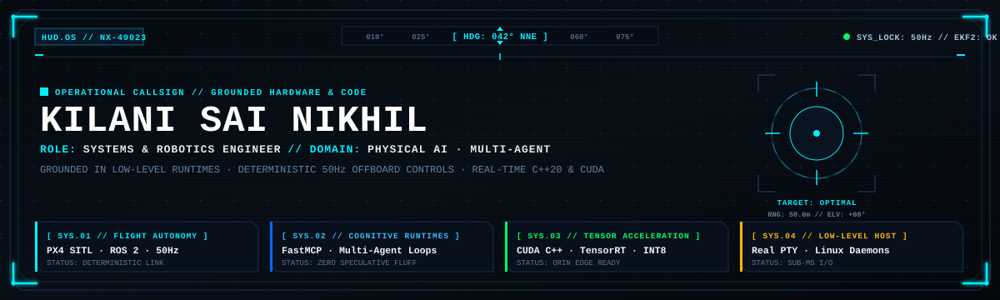
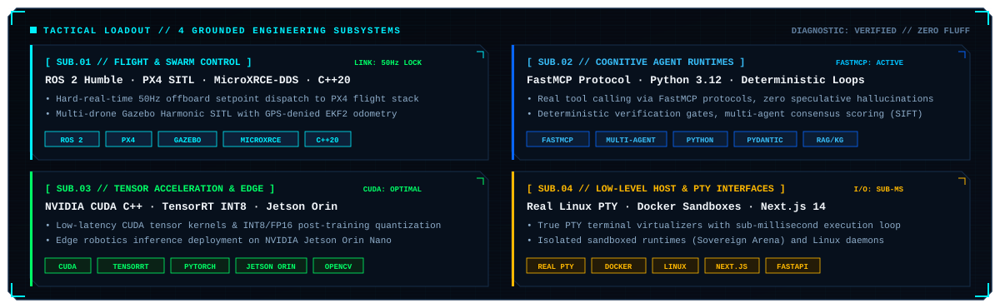
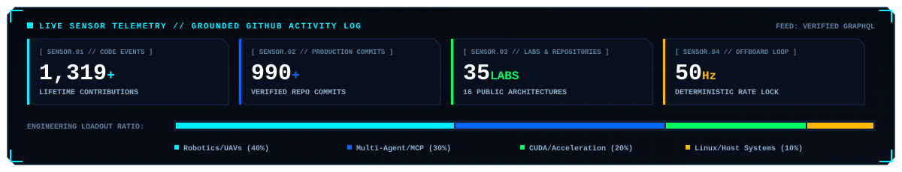

<!-- ================================================================= -->
<!-- TACTICAL HUD // GROUNDED SYSTEMS & ROBOTICS ARCHITECTURE          -->
<!-- SYS_ID: NX-49023 // CALLSIGN: KILANI SAI NIKHIL                   -->
<!-- ================================================================= -->

  

  
  
  
  

---

### `[ 01 // TACTICAL SUBSYSTEM LOADOUT ]`

  

 

---

### `[ 02 // FIELD ASSETS & DEPLOYED SYSTEMS ]`

| ASSET DESIGNATION | TACTICAL CAPABILITIES & HARDWARE SPECS | AVIONICS & STATUS |
| :--- | :--- | :---: |
| 🛸 **[Project SUTRA](https://github.com/nikhil49023/SUTRA)** `CLASS: MULTI-UAV SWARM` | • Deterministic 50Hz offboard setpoint streaming to PX4 flight stack • MicroXRCE-DDS client-agent bridge for high-rate uORB telemetry • Multi-agent SITL physics validation in Gazebo Harmonic • GPS-denied EKF2 odometry fusion and spatial coordinate lock | `ROS 2 Humble` `PX4 SITL` `C++20`  `● ACTIVE SITL` |
| ⚔️ **[Sovereign Arena](https://github.com/nikhil49023/sovereign-arena)** `CLASS: PTY COCKPIT` | • True PTY terminal virtualizer with sub-millisecond execution loop • Sandboxed multi-language compilation & isolated runtime containers • Monaco Editor core integration with live terminal multiplexing • Bi-directional Obsidian knowledge sync for engineering logs | `Next.js 14` `Monaco Engine` `Real Linux PTY`  `● STABLE v1.2` |
| 🧠 **[SIFT Engine](https://github.com/nikhil49023/sift)** `CLASS: DECISION INTELLIGENCE` | • Multi-agent engineering profiling & objective rubric evaluation • FastMCP protocol tool-calling execution pipelines • Multi-round consensus & score divergence reconciliation • Deterministic decision graphs without speculative hallucination | `FastMCP` `Python 3.12` `Multi-Agent`  `● DEPLOYED` |
| ⚡ **[OmniForge](https://github.com/nikhil49023/omniforge)** `CLASS: FAST_MCP SYNTHESIZER` | • Automated technical documentation scraper & FastMCP server generator • Headless crawler engine coupled with Groq LPU low-latency triage • Deterministic schema validation for structured agent toolkits • Zero-overhead local server deployment pipelines | `FastMCP` `Firecrawl` `Groq LPU`  `● PRODUCTION` |
| 🖥️ **[SAARA Desktop](https://github.com/nikhil49023/saara-desktop)** `CLASS: EDGE SYSTEM ENGINE` | • On-device tool calling and persistent local vector knowledge stores • Air-gapped privacy preservation and local GPU kernel dispatch • Direct OS interface automation via native Linux IPC and PTY • Continuous background task scheduling and telemetry capture | `Python` `Edge AI` `Linux PTY`  `● ACTIVE` |
| 🌐 **[AGY Hyperdrive](https://github.com/nikhil49023/agy-hyperdrive)** `CLASS: AGENT HARNESS` | • Antigravity CLI workspace configurations, skills, and MCP toolchains • Deterministic maker/checker verification gates and test harnesses • Multi-platform developer tooling orchestrations (Linux / Mac / Win) • Automated error diagnosis, self-healing, and loop engineering | `MCP Tools` `Bash / Python` `Workflows`  `● VERIFIED` |

---

### `[ 03 // LIVE SENSOR TELEMETRY ]`

  

 

---

### `[ 04 // AVIONICS ARSENAL & SYSTEMS MATRIX ]`

#### `[ CORE RUNTIMES & COMPUTATION ]`

  
  
  
  
  
  

#### `[ ROBOTICS, SWARM & PHYSICAL AI ]`

  
  
  
  
  
  

#### `[ ACCELERATION & COGNITIVE RUNTIMES ]`

  
  
  
  
  
  

#### `[ HOST INTERFACES & INFRASTRUCTURE ]`

  
  
  
  
  
  

---

### `[ 05 // COMMS_LINK & SECURE DISPATCH ]`

  
  &nbsp;&nbsp;
  
  &nbsp;&nbsp;
  

 

  

